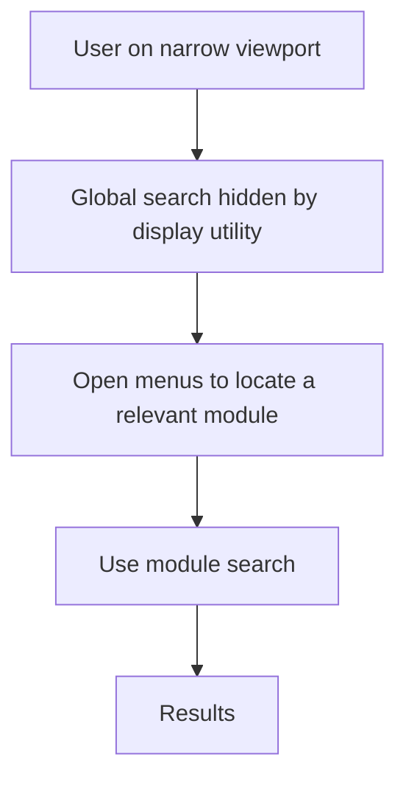
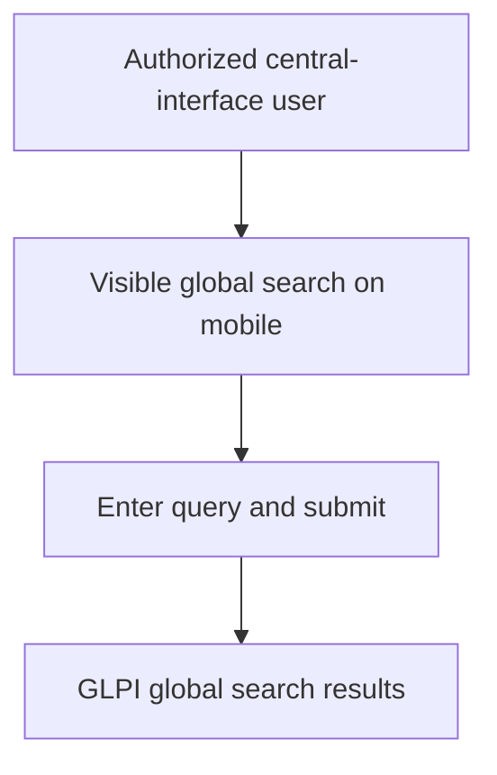
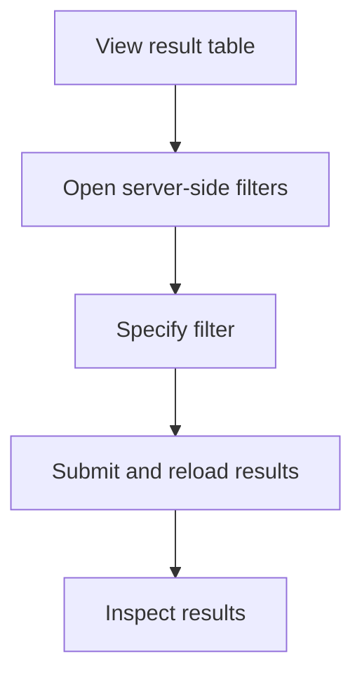
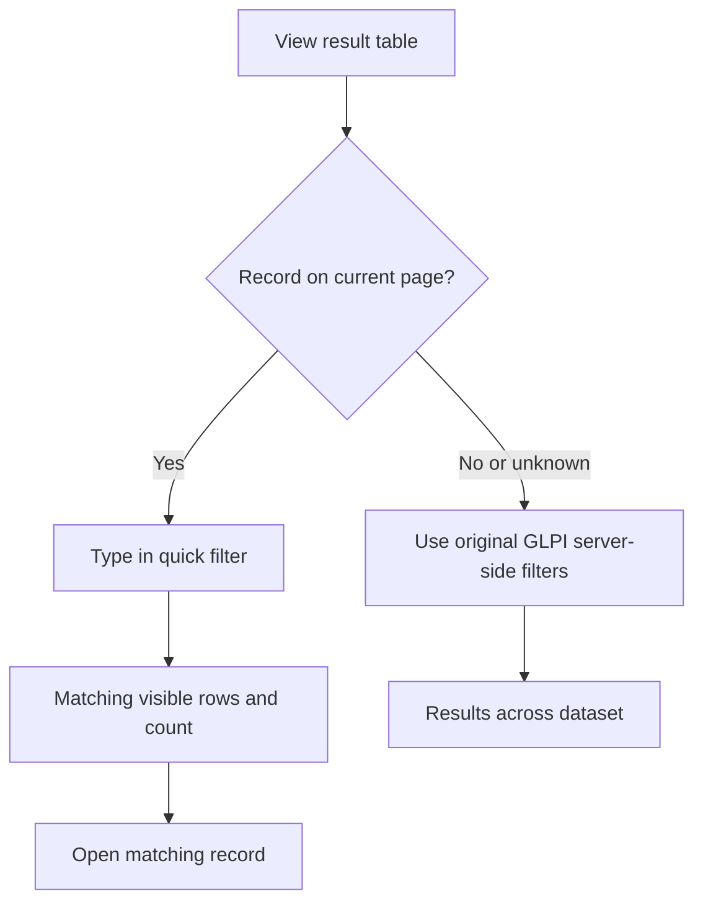
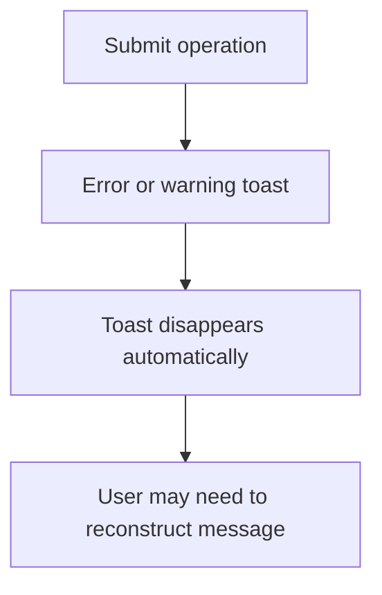
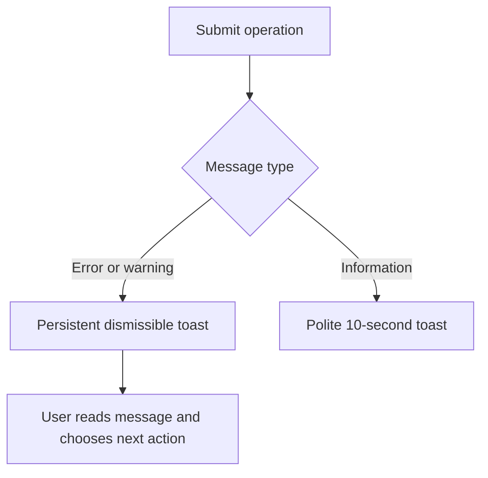

# User flow redesign — proposals

These are **proposed** flows based on GLPI's source UI; live navigation paths and permissions must be validated in staging.

## 1 — Global search on mobile

### Before (source-derived)

### After (this PR)

## 2 — Find a record in an existing page of results

### Before

### After (this PR, only visible rows)

## 3 — Failed operation feedback

### Before

### After (this PR, presentation only)

Server-side validation detail and recovery actions remain future work; this patch does not invent remediation details for unknown server errors.

## Further workflows needing actual-role testing
Create ticket, assign ticket, save edits in multi-section asset forms, approve request, create a knowledge item, edit list with bulk actions. For each measure clicks, active time, failures, abandoned attempts, rework, and roles.
